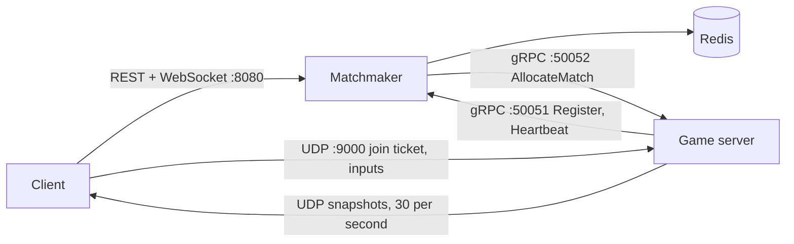

# mini-online

Disclaimer: this is just the networking part with a small movement logic for the client, all the rendering / visualization for the interaction between the client and the server or client to client is done through the console

A small online game backend in C++: an authoritative UDP game server, a matchmaking service, and game clients for Linux and Windows. I built it to learn how the pieces of a multiplayer backend fit together, end to end: authentication, matchmaking, session management, netcode, deployment and testing.

> **Status:** a learning prototype. It runs and is tested (see [Tests and measurements](#tests-and-measurements)), but it is not hardened for the open internet. See [Limitations and what I'd improve](#limitations-and-what-id-improve).

## What's in it

- **Authoritative game server** (UDP): fixed 30 Hz tick, input validation and rate limiting, snapshots to every client each tick.
- **Matchmaker** (REST + WebSocket + gRPC): login, queue, pairing, game server registry, signed join tickets, sessions in Redis.
- **Clients** (Linux and Windows): client side prediction, reconciliation, snapshot interpolation.
- **Deployment**: Docker images and a compose file, run on a Raspberry Pi.
- **Tooling**: end to end test script, fuzzer, flood test, capture and profiling helpers.

## Architecture



### Components

- `server/`: the game server
  - One UDP socket, one `poll()` loop, a fixed 30 Hz tick
  - Applies validated inputs on arrival and sends each client a snapshot every tick
  - Runs a gRPC control server (`AllocateMatch`) and a background thread that registers with the matchmaker and sends heartbeats
- `matchmaker/`: the matchmaking service
  - REST (cpp-httplib): `/login`, `/queue`, `/match`, `/session/:id`, `/servers`, `/health`
  - WebSocket `/ws`: pushes "waiting" and "matched" to a queued player
  - gRPC registry (`Register`, `Heartbeat`) so it knows which game servers are alive
  - Redis (hiredis) keeps matched sessions, with a 1 hour TTL
- `client/`: the game client (Linux and Windows)
  - Predicts its own movement and replays unacknowledged inputs on each snapshot
  - Draws other players 100 ms in the past, interpolated between snapshots
- `mmclient/`: a small matchmaking client (login, WebSocket, queue, wait for a match)
- `common/`: shared code
  - `game.proto` (client and server messages) and `control.proto` (gRPC services)
  - `protocol.h`: constants and `applyInput`, which client and server both run so prediction matches
  - `net_platform.h`: Winsock vs POSIX
- `fuzz/`: a seeded packet fuzzer. `protodemo/`: a protobuf wire format demo
- `third_party/`: header only libraries (cpp-httplib, nlohmann/json, jwt-cpp)

### From login to playing

1. A game server starts, registers with the matchmaker over gRPC and sends a heartbeat every 2 seconds.
2. A client calls `POST /login` and gets a JWT (audience `matchmaker`, 10 minutes).
3. The client calls `POST /queue`. The first player waits, and the second player triggers pairing. A WebSocket on `/ws` pushes the result so the client doesn't have to poll `GET /match`.
4. The matchmaker picks the least loaded game server that sent a heartbeat in the last 6 seconds and has room for two. It calls `AllocateMatch` on it, saves the session in Redis, and issues a join ticket per player.
5. The client sends a `Join` carrying the ticket over UDP. The server verifies the signature, audience and expiry, checks that the session was allocated and the player belongs to it, then registers the client.
6. The client sends `Input` messages (`seq`, `dx`, `dy`) at 30 per second. The server validates and applies them, and answers with a `Snapshot` every tick.

### Netcode

- **Server authoritative:** clients send inputs, never positions.
- **Prediction and reconciliation:** the client applies each input immediately and keeps it in a pending list. Every snapshot carries `last_seq`, the last input the server applied. The client drops acknowledged inputs, resets to the server position and replays the rest.
- **Interpolation:** remote players are rendered about 100 ms behind the newest snapshot, which hides jitter and single lost packets at the cost of latency.
- **Reliability:** continuous state is unreliable by design, because a lost snapshot is replaced 33 ms later. Inputs carry a sequence number, and old or duplicate ones are ignored.

### Validation and security (implemented)

| Area | What it does |
|---|---|
| Input | `dx`/`dy` clamped to -1..1, diagonal speed normalized, world bounded |
| Rate limit | per client token bucket (about 33 inputs/s, burst 5) |
| Join tickets | JWT (HS256, algorithm pinned), audience `game server`, session id, unique `jti`, 30 s lifetime, size capped before decoding |
| Replay | each ticket is bound to the first address that used it, and a player can only be connected from one address at a time |
| Allocation | the game server only accepts sessions the matchmaker allocated over gRPC |
| Tokens | login tokens (audience `matchmaker`) and join tickets can't be used in place of each other |
| Network exposure | only 8080 and 9000/udp are published by compose; gRPC and Redis stay on the private network |
| Observability | one stats line per second instead of a log line per packet |

## Build and run

### Linux

```bash
./setup.sh                                  # apt dependencies, once (Debian/Ubuntu)
cmake -S . -B build && cmake --build build
```

Run everything locally:

```bash
redis-server &                       # sessions
./build/matchmaker/matchmaker &      # REST + WebSocket :8080, gRPC :50051
./build/server/server &              # UDP :9000, registers with the matchmaker
./test_flow.sh localhost             # 11 end-to-end checks
./play.sh localhost alice            # run in two terminals, alice and bob
./play.sh localhost bob
```

### Docker (what runs on the Pi)

```bash
PI_ADDR=<address clients will use> docker compose up --build -d
docker compose ps
```

`./deploy.sh <ssh-alias>` copies the source to the target, rebuilds the images there, and passes the target's address as `PI_ADDR`. Helper commands (`status`, `logs`, `capture`, `profile`) are in `pitool.sh`.

### Windows (clients only)

The server and matchmaker are Linux only by design. Requirements: Visual Studio with the C++ workload, Git and CMake.

```powershell
git clone https://github.com/microsoft/vcpkg C:\vcpkg
C:\vcpkg\bootstrap-vcpkg.bat
cmake -S . -B build-win -DCMAKE_TOOLCHAIN_FILE=C:/vcpkg/scripts/buildsystems/vcpkg.cmake
cmake --build build-win --config Release
```

`vcpkg.json` declares the dependency (protobuf). The result is `build-win\client\Release\client.exe`, with the DLLs it needs next to it, so ship the whole folder.

### Configuration

| Variable | Service | Default | Meaning |
|---|---|---|---|
| `MM_SECRET` | both | development value | HMAC secret for the JWTs. **Set your own**, and keep it identical on both |
| `REDIS_HOST` | matchmaker | `127.0.0.1` | Redis address |
| `MM_GRPC_ADDR` | game server | `localhost:50051` | where to register |
| `GAME_PUBLIC_ADDR` | game server | `127.0.0.1:9000` | UDP address handed to clients |
| `GAME_CONTROL_ADDR` | game server | `127.0.0.1:50052` | where the matchmaker calls `AllocateMatch` |
| `PI_ADDR` | compose | none | public host used for `GAME_PUBLIC_ADDR` |

## Tests and measurements

All numbers come from my own runs on a Raspberry Pi 5 and a laptop. Treat them as measurements of this setup, not benchmarks.

### End to end test

`test_flow.sh <host>` runs 11 checks: authentication, pairing, 401/403/409 cases, a join ticket rejected as a bearer token, two clients receiving snapshots, and a forged ticket receiving nothing. It passes on a LAN and across two networks over an overlay VPN. A Windows client and a Linux client also played in the same session.

### Bad network (`tc netem` on the server's outgoing traffic, so snapshots only)

| Scenario | pending inputs | snapshots/s | corrections | smoothness of remote players |
|---|---|---|---|---|
| clean | 1 | 30 | 0 | steady (0.167 per tick) |
| +50 ms | 3 | 30 | 0 | steady |
| +150 ms, 20 ms jitter | 5-6 | 29-31 | 0 | stutters: steps up to ~0.35, 0-3 stalls/s |
| same + 5% loss | 5-6 | 25-31 | 0 | similar, a few stalls and jumps |

A correction means: the server’s position plus my unacknowledged inputs is not where I predicted I’d be. That can only happen if the server applied a different set of inputs than the client assumes. In those runs it never did:

- Client and server run the same deterministic function (applyInput) over the same inputs, in the same order.
- netem only touched the server’s outgoing traffic, so every input arrived and was applied. Delayed or lost snapshots change the lead, not the result, because the acknowledgement is cumulative.

> **Disclaimer:** The data in this table was collected at an earlier stage of the matchmaking and server implementation, before the protobuf messages, join tickets, session allocation, Redis session storage, input rate limiter and metrics were added. The prediction, reconciliation and interpolation code was already in place and has not changed since. No new measurements were collected for the current version of the server and client, or for a connection over the internet.
>
> Network emulation (`tc netem`) was applied only to the server's outgoing traffic. Client inputs were therefore never delayed or lost, and the corrections column remains at 0 by construction. Reconciliation was exercised later, in the flood test, where starved inputs raised corrections to between 8 and 30 per second and filled the pending-input buffer to its limit of 120. Both returned to normal within one second of the flood ending.


`pending` tracks round trip time divided by the tick length. Constant delay is harmless, and jitter is what hurts interpolation, because the render clock is re anchored on every snapshot.

### Flood and packet capture

- **Flood from one machine over WiFi:** the server stayed healthy (no socket buffer drops, ticks within 0.1 ms, low CPU), but legitimate players' inputs fell from 30 per second to about 1 for roughly 20 seconds while snapshots kept flowing. A ping during the flood lost 37 of 40 packets, so the shared uplink was saturated, not the server.
- **Log volume:** logging a line per bad packet wrote 167 MB in 15 seconds under a direct cable flood. With counters and a one second summary, the same kind of flood writes about 20 KB.
- **Bandwidth (2 players, tcpdump and tshark):** 30 packets per second each way per player, about 1.4 kB/s up and 2 kB/s down. Headers are 42 of the roughly 49 bytes of an input frame. Downstream per player grows linearly with player count, and the server's total output grows with its square.

### Fuzzing

A seeded fuzzer sent random and truncated packets (5 seeds, 200,000 packets each) at a server built with AddressSanitizer and UBSan: no findings. It only reaches unauthenticated code paths. See the limitations below.

## Scalability

> These are design notes. Only one game server and one matchmaker were run, and none of the points below were load-tested.

### Vertical scaling (a larger machine)

- The game server's tick loop is single-threaded, so one process uses one core. At two players it used little CPU (under 5% in `top`), and on loopback it kept its tick schedule (at most 0.5 ms late) while receiving 40,000 to 90,000 junk packets per second.
- A faster core and a faster network card raise the ceiling per process, but only up to the limits of one core and one network link. Beyond that, scaling means more processes, or splitting the work across threads.
- Bandwidth grows faster than the player count: each player receives every other player's state, so the server's total output grows with the square of the number of players (estimated at about 1.5 MB/s for 64 players, from the 2 player capture).

### Horizontal scaling (more machines)

| Layer | Today | What scaling would require |
|---|---|---|
| Game servers | The registry, heartbeats and least-loaded selection already support several instances, but only one was run | Distinct public addresses and ports per instance, capacity measured in matches or CPU instead of an entity cap of 8, draining before shutdown, and an orchestrator to add and remove instances (for example Kubernetes with an Agones-style allocator) |
| Rooms inside a server | A game server is one shared world: every connected client appears in every snapshot, even though the matchmaker may place several matches on one server | Separate rooms per session inside the process, or one process per match |
| Matchmaker | Stateless except for the waiting list and the registry, which live in process memory | Several instances behind a load balancer, with the queue and the registry moved into shared storage |
| Queue pairing | A mutex inside one process | An atomic pairing step in Redis (a Lua script or `MULTI`/`WATCH`) |
| Match notification | A WebSocket is held by the instance the client connected to | Redis pub/sub or a message queue, so any instance can notify the instance holding the socket |
| Session state | Redis, with a one hour TTL | Replication and persistence, or a managed service; the same store can be shared by every matchmaker |
| Edge | Nothing in front of the servers | Rate limiting and filtering at the edge, since a flood cannot be handled inside the game loop |

### Distance and regions

- Latency has a physical floor: light in optical fibre travels roughly 1,000 km in 5 ms, so a round trip costs about 10 ms per 1,000 km before any routing or processing.
- A larger player base would be served by game servers in several regions, with a global login and matchmaking layer. The matchmaker would pick a region from measured round-trip time (clients ping a regional endpoint) and keep one queue per region.
- Cross-region matches trade fairness for latency: they widen the pool of opponents but add delay for at least one player, so they are usually a fallback when a region's queue is too short.
- Authentication and tickets can stay global because they only require a shared signing key. Session data would be kept per region to avoid cross-region database calls on the hot path.

### What to measure before scaling

The existing one-second stats line already reports players, packets in and out, tick lateness and inputs per second per player. The numbers needed for capacity planning are players per core at a stable 30 Hz tick, bandwidth per player, matches per server, and matchmaker requests per second.

## Limitations and what I'd improve

| Area | Today | Improvement |
|---|---|---|
| Matchmaking queue | the waiting list is in the matchmaker's memory and entries never expire, so an abandoned player pairs with the next newcomer | expire entries after a timeout, then move the queue into Redis with an atomic pairing step so several matchmakers can run |
| Registry and failover | dead game servers stay listed (matching skips them), and a stored session keeps its original server | evict servers after about 30 s without a heartbeat, and reallocate a session when its server is gone |
| `/queue` locking | holds a mutex during a gRPC call (2 s deadline) and opens a new channel per allocation | reserve the players, call without the lock, reuse the channel |
| Transport security | UDP is plaintext (a ticket is readable in a capture), HTTP and gRPC have no TLS, one shared development secret | DTLS or application level encryption, TLS everywhere, secrets from a secret store, a challenge/cookie handshake against spoofed addresses |
| Identity | `/login` accepts any name | real credentials or a platform identity ticket |
| Flood resistance | a forged join costs an HMAC, there is no per IP limit on unauthenticated packets, and a `continue` in the receive loop skips the tick code (not reproduced, even at 90k packets/s on loopback) | per  source limits before any parsing, handle packets in a function instead of `continue`, filtering upstream |
| Fuzzing | unauthenticated paths only; a valid looking join was never generated | fuzz the JWT decoding and the joined client paths with real tickets |
| Netcode | no lag compensation, no reliable event channel, every player sees every entity (cap 8) | interest management, delta compression and quantization, a reliable layer with event ids and acks |
| Interpolation | render time follows each snapshot's arrival, so jitter leaks into it | a smoothed server clock offset |
| Peer to peer | not implemented | NAT traversal (STUN style discovery, hole punching, relay fallback) |
| Observability | logs only, max tick lateness only | export metrics, a tick time histogram, dashboards |
| Delivery | no CI; the Windows build needs the whole `Release` folder and the VC++ runtime | GitHub Actions building both platforms, a static Windows build, a client that does login, queue and ticket handoff itself |
| Reconnects | a legitimate reconnect from a new port is blocked for up to 10 s by the duplicate player check | resume tokens |

## Repository layout

```
common/       game.proto, control.proto, protocol.h, net_platform.h
server/       game server (UDP) and its Dockerfile
matchmaker/   REST, WebSocket, gRPC registry, Redis store, and its Dockerfile
client/       game client (prediction, reconciliation, interpolation)
mmclient/     matchmaking client
fuzz/         packet fuzzer
protodemo/    protobuf wire-format demo
third_party/  cpp-httplib, nlohmann/json, jwt-cpp
compose.yaml  matchmaker + game server + Redis
vcpkg.json    Windows dependencies
setup.sh      Linux dependencies
deploy.sh  test_flow.sh  play.sh  ticket.sh  pitool.sh  flood_test.sh
```